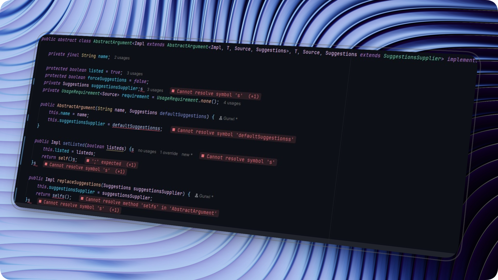

<div align="center">

# LintVision

**Inline diagnostics for JetBrains IDEs. See errors and warnings at the end of the line, right where they happen.**



[](https://plugins.jetbrains.com/plugin/35068-lintvision)

[](https://plugins.jetbrains.com/plugin/35068-lintvision)
[](https://plugins.jetbrains.com/plugin/35068-lintvision)
[](LICENSE)

[Install](#installation) · [Features](#features) · [Configuration](#configuration) · [Contributing](#contributing)

</div>

---

## Why LintVision?

Normally, finding out *why* a line is underlined means hovering over it or opening the Problems panel. That pulls your eyes away from the code and breaks your flow.

LintVision prints the message directly after the offending line, so you can read it at a glance and keep typing. It is inspired by [Error Lens](https://marketplace.visualstudio.com/items?itemName=usernamehw.errorlens) for VS Code, built natively for the IntelliJ Platform.

## Features

- **Inline diagnostics**: inspection messages appear at the end of the line that triggered them.
- **Severity filtering**: choose whether errors, warnings, weak warnings, and informational messages are shown.
- **Custom appearance**: per-severity colors, background tint, border radius, spacing, italic and bold text.
- **Message templates**: control the exact output with `$message`, `$count`, `$severity`, `$source`, and `$code`.
- **Noise control**: set a maximum message length, hide messages that match a regular expression, and tune the update delay.
- **Multiple diagnostics per line**: show a counter when a line has more than one message.
- **Easy to toggle**: enable or disable LintVision at any time to suit your workflow.

## Installation

### From the JetBrains Marketplace (recommended)

1. Open your JetBrains IDE.
2. Go to **Settings → Plugins → Marketplace**.
3. Search for **LintVision** and click **Install**.
4. Restart the IDE if prompted.

Or install directly from the [plugin page](https://plugins.jetbrains.com/plugin/35068-lintvision).

### From disk

1. Download a release `.zip` from the plugin page or the repository's releases.
2. Go to **Settings → Plugins → ⚙ → Install Plugin from Disk…** and select the file.

## Compatibility

|           | Supported                                     |
|-----------|-----------------------------------------------|
| IDE build | 243 and newer (IntelliJ Platform 2024.3+)     |
| IDEs      | JetBrains IDEs built on the IntelliJ Platform |

Diagnostics shown depend on the inspections available in your IDE and language. If a specific IDE or language doesn't behave as expected, please [open an issue](https://github.com/Gurwi30/lint-vision/issues).

## Configuration

Open **Settings → Tools → LintVision**.

| Category   | What you can change                                                     |
|------------|-------------------------------------------------------------------------|
| Severities | Which of errors, warnings, weak warnings, and information are displayed |
| Colors     | A separate color for each severity                                      |
| Appearance | Background tint, border radius, spacing, italic and bold text           |
| Messages   | Templates, severity labels, maximum message length                      |
| Behavior   | Extra message counts, regex exclusions, update delay                    |

### Message templates

Templates decide how each inline message is formatted. Combine plain text with these variables:

| Variable    | Description                    |
|-------------|--------------------------------|
| `$message`  | The inspection message         |
| `$count`    | Number of messages on the line |
| `$severity` | Severity of the diagnostic     |
| `$source`   | Where the diagnostic came from |
| `$code`     | The diagnostic code            |

A few ideas:

```text
$message
$severity: $message
$message ($source)
[$code] $message
```

### Hiding noisy messages

Use the regex exclusion setting to suppress messages you don't care about. For example, `(?i)typo|spelling` hides spelling-related messages.

## Contributing

Bug reports, feature ideas, and pull requests are welcome.

1. Fork the repository.
2. Create a branch for your change.
3. Make and test your changes.
4. Open a pull request with a clear description of what and why.

Found a bug or have a suggestion? Use [GitHub Issues](https://github.com/Gurwi30/lint-vision/issues). When reporting a bug, including your IDE name and version helps a lot.

## License

LintVision is open source. See [LICENSE](LICENSE) for details.

---

<div align="center">

**Less context switching. More flow.**

[JetBrains Marketplace](https://plugins.jetbrains.com/plugin/35068-lintvision) · [GitHub](https://github.com/Gurwi30/lint-vision) · Made by [Gurwi](https://www.gurwi.dev)

</div>